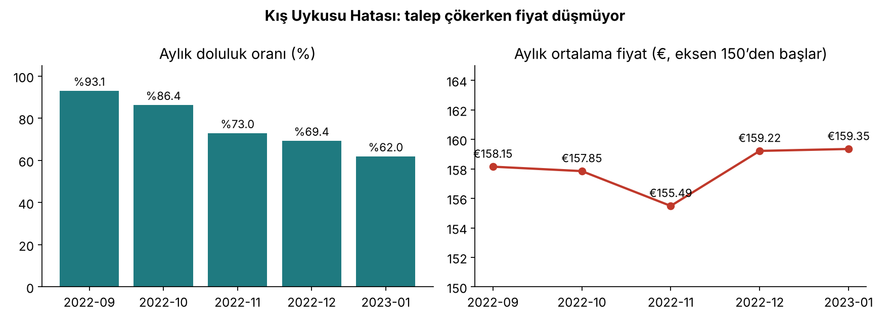
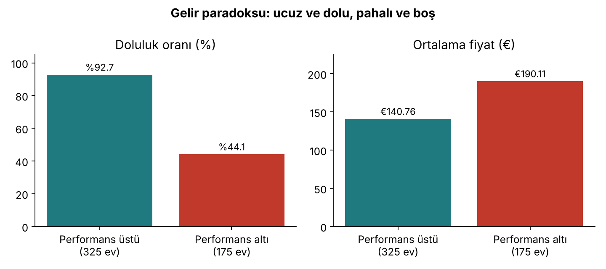

# Paris Airbnb Analizi: Performans, Fiyat ve Doluluk

Paris'teki 500 Airbnb ilanının doluluk, fiyat, misafir puanı ve ev sahibi yanıt süresi verisini BigQuery SQL ile analiz eden bir veri analizi projesi. Amaç, genel ortalamaların arkasında kalan ilanların neden geride kaldığını bulmak.

## Öne çıkan bulgular

| Bulgu | Sonuç |
|---|---|
| Pazar ortalaması | 500 ilan, %75.7 doluluk, €158.02 fiyat, 4.67 puan |
| Performans üstü (325 ilan) | %92.7 doluluk, €140.76 |
| Performans altı (175 ilan) | %44.1 doluluk, €190.11 |
| Yanıt süresi birkaç günü bulanlar (22 ilan) | Ortalama puan 4.24 (diğer gruplarda 4.68–4.70) |
| Eylül 2022 → Ocak 2023 | Doluluk %93.1 → %62.0, fiyat €158.15 → €159.35 |




Tam yorum ve aksiyon önerileri: [`reports/paris_airbnb_stratejik_rapor.md`](reports/paris_airbnb_stratejik_rapor.md)

## Klasör yapısı

```
sql/
  01_genel_analizler.sql              genel KPI, oda tipi, yanıt süresi, aylık trend, performans sınıfı
  02_asagi_kalma_sebepleri_ozeti.sql  performans altı ilanlarda sebep kombinasyonları ve ilan sayıları
  03_performans_alti_ilanlar.sql      performans altı ilanların ilan bazlı listesi
results/analiz_sonuclari.csv          01 numaralı sorgunun çıktısı
charts/                               sonuçlardan üretilen grafikler
reports/                              yorumlu rapor
make_charts.py                        grafikleri üretir
check_results.py                      rapordaki sayıları sonuç tablosuyla karşılaştırır
```

## Yöntem

- Veri iki tabloda: `listing` (ilan bilgileri) ve `calendar` (günlük takvim, fiyat ve müsaitlik).
- Fiyatı boş veya 0 olan takvim satırları çıkarıldı.
- **Doluluk oranı** = takvimde `available = false` olan günlerin oranı.
- **Performans sınıfı:** ilanın doluluk oranı pazar ortalamasına (%75.7) eşit veya üstündeyse "Performans Üstü", altındaysa "Performans Altı".
- Sebep analizinde pazar ortalamasının altındaki puan, üstündeki fiyat ve "a few days or more" yanıt süresi işaretlendi.

## Nasıl çalıştırılır

1. Sorguları BigQuery'de çalıştır. Tablo adındaki `data-analytics-469406.airbnb` kısmını kendi proje ve veri setinle değiştir.
2. Veri kaynağı olarak Inside Airbnb'in Paris verisi kullanılabilir (listings ve calendar dosyaları).
3. Grafikleri yeniden üretmek için: `pip install pandas matplotlib`, ardından `python make_charts.py`
4. Rapordaki sayıların tabloyla uyumunu denetlemek için: `python check_results.py`

## Sınırlar

- Doluluk, rezervasyon ile ev sahibinin kapattığı günleri ayırmaz.
- Veri Eylül 2022 – Ocak 2023'ü kapsar, yıllık sezon sonucu çıkarılamaz.
- Fiyat ile doluluk arasındaki ilişki gözlemseldir, neden-sonuç kanıtı değildir.
- Paylaşımlı oda segmenti 1 ilandır, yanıt süresi "birkaç gün" grubu 22 ilandır; bu gruplardan genel sonuç çıkarılmamalı.
